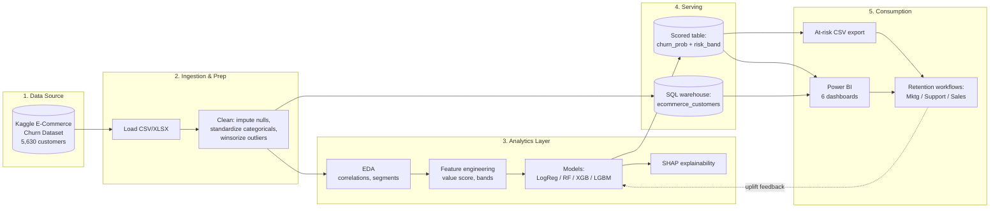
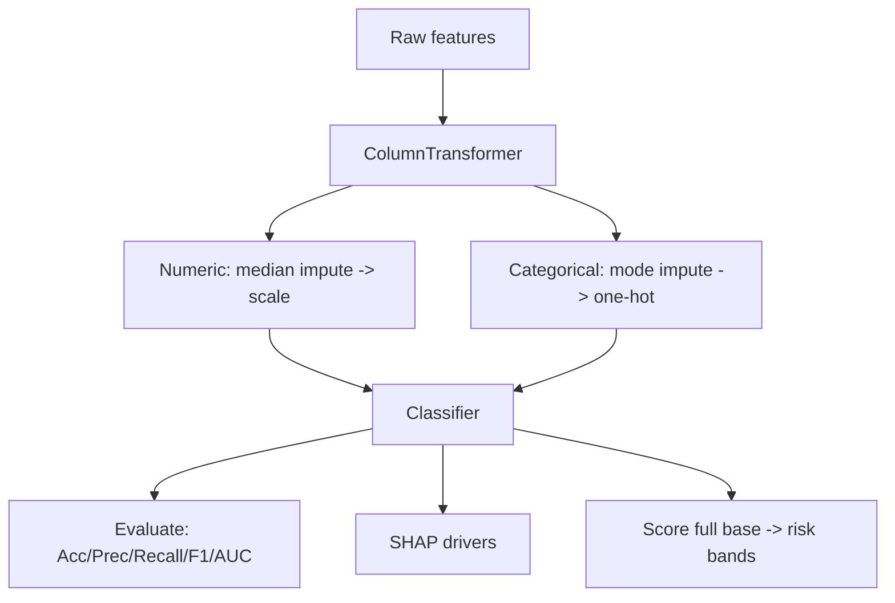

# Project Architecture

## End-to-End Solution Architecture



## Layer Responsibilities
| Layer | Tools | Output |
|---|---|---|
| **Data Source** | Kaggle dataset | Raw customer attributes |
| **Ingestion & Prep** | Python (pandas), Power Query | Clean modeling table |
| **Analytics** | scikit-learn, XGBoost, LightGBM, SHAP | Trained model + drivers |
| **Serving** | CSV / SQL | Scores, risk bands, KPIs |
| **Consumption** | Power BI, CRM | Dashboards, action lists, campaigns |
| **Feedback loop** | Campaign results | Retraining signal |

## Folder Structure
```
ecommerce-churn-ba-project/
├── README.md
├── docs/
│   ├── 01_business_understanding.md
│   ├── 02_stakeholder_analysis.md
│   ├── 03_requirements.md
│   ├── 04_process_mapping.md
│   ├── 05_eda_findings.md
│   ├── 09_business_recommendations.md
│   ├── 10_business_impact.md
│   ├── BRD.md
│   ├── FRD.md
│   ├── user_stories_use_cases.md
│   ├── data_dictionary.md
│   ├── wireframes.md
│   └── executive_summary.md
├── sql/
│   ├── 00_schema.sql
│   └── business_questions.sql
├── notebooks/
│   └── churn_analysis.py
├── powerbi/
│   └── dashboard_spec.md
├── architecture/
│   └── architecture.md
├── resume/
│   └── resume_bullets.md
└── data/                      ← (you add the dataset here)
    └── ecommerce_churn.csv
```

## Modeling Pipeline (detail)

