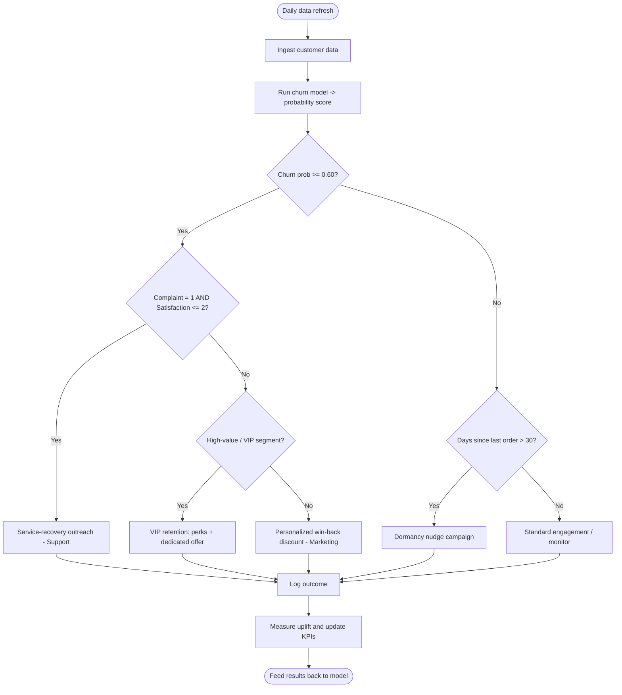
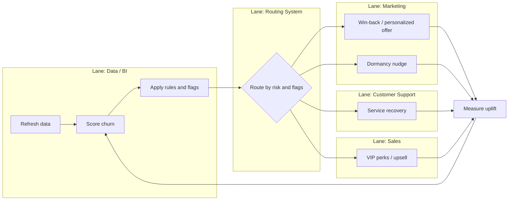

# Phase 4 — Process Mapping

## 4.1 Current (As-Is) Customer Journey

The current journey is **reactive** — the business only learns a customer is unhappy after they complain, and only learns they churned after they're gone.

```
[Acquire] → [Onboard] → [Browse & Order] → [Fulfillment] → [Use/Receive]
     │           │             │                 │              │
     ▼           ▼             ▼                 ▼              ▼
  Generic     No early      Untargeted       Long warehouse   Issue arises
  welcome     engagement    promotions       distance =       → Complaint
              tracking                        delays           │
                                                               ▼
                                              [Complaint logged] → slow/uneven resolution
                                                               │
                                                               ▼
                                              Dissatisfaction rises → Days-since-last-order grows
                                                               │
                                                               ▼
                                              ❌ CUSTOMER CHURNS (discovered after the fact)
```

**As-Is pain points:**
1. No tenure-based onboarding → new customers (highest churn risk) get no special attention.
2. Complaints handled slowly and inconsistently → complaint strongly predicts churn.
3. Promotions are untargeted → spend wasted, low relevance.
4. Churn detected only *after* it happens → no chance to intervene.
5. Fulfillment friction (warehouse distance) not linked to retention action.

## 4.2 Future (To-Be) Customer Journey

The future journey is **proactive and predictive** — the model continuously scores risk and triggers the right intervention at the right moment.

```
[Acquire] → [Smart Onboard] → [Engage] → [Predict & Score] → [Intervene] → [Retain/Grow]
     │            │               │             │                  │             │
     ▼            ▼               ▼             ▼                  ▼             ▼
  Welcome +   Tenure-based     Personalized   Daily churn      Risk-based     Loyalty/VIP
  segment     onboarding for   offers by      scoring +        plays:         program,
  tagging     first 90 days    category &     early-warning    - service      rising CLV
              (high-risk)      cashback       flags            recovery
                                              │                - win-back
                                              ▼                - VIP perks
                                       Auto-flag:              - dormancy
                                       complaint+low-sat,      nudge
                                       dormant >30d,
                                       prob ≥ 0.60
```

**To-Be improvements:**
- Early-warning model flags risk **before** churn.
- Complaint + low satisfaction → automatic service-recovery workflow (BRule-04).
- Personalized offers replace mass promotions.
- High-value at-risk customers routed to VIP retention.
- Dormant customers (>30 days) nudged automatically.

## 4.3 Process Flow — Churn Prevention (swimlane narrative)

| Step | Actor | Action |
|---|---|---|
| 1 | Data/BI | Ingest & refresh customer data daily |
| 2 | Model | Score churn probability for all customers |
| 3 | Model | Apply business rules → risk band + flags |
| 4 | System | Route flagged customers to the right play |
| 5 | Marketing | Execute targeted retention/win-back campaign |
| 6 | Support | Handle service-recovery for complaint+low-sat customers |
| 7 | Sales | Upsell/VIP perks for high-value retained customers |
| 8 | Data/BI | Measure campaign uplift, feed back to model & KPIs |

## 4.4 BPMN Diagram (Churn Early-Warning & Retention)



### BPMN swimlane view (pools/lanes)



> Render the Mermaid blocks in any Markdown viewer that supports Mermaid (GitHub, VS Code, Obsidian) to see the diagrams visually.
